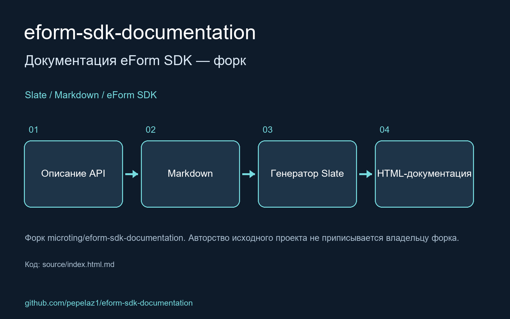

### Prerequisites

You're going to need:

 - **Linux or OS X** — Windows may work, but is unsupported.
 - **Ruby, version 2.2.5 or newer**
 - **Bundler** — If Ruby is already installed, but the `bundle` command doesn't work, just run `gem install bundler` in a terminal.

### Getting Set Up

1. Fork this repository on Github.
2. Clone *your forked repository* (not our original one) to your hard drive with `git clone https://github.com/YOURUSERNAME/slate.git`
3. `cd slate`
4. Initialize and start Slate. You can either do this locally, or with Vagrant:

```shell
# either run this to run locally
bundle install
bundle exec middleman server

# OR run this to run with vagrant
vagrant up
```

You can now see the docs at http://localhost:4567. Whoa! That was fast!

<!-- portfolio-visual:start -->
## Схема работы



Схема подготовлена по README и исходному коду. Запуск приложения не проверялся. Репозиторий является форком [microting/eform-sdk-documentation](https://github.com/microting/eform-sdk-documentation); схема поясняет устройство документации SDK.
<!-- portfolio-visual:end -->
